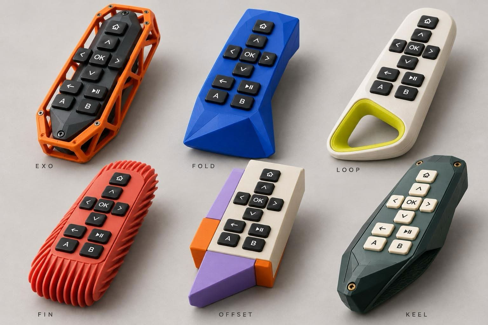

# Enclosure concepts

`enclosure-concepts.jpg` is the reference concept sheet: six expressive shells around one shared ten-key layout. It is an AI-generated mood image, not a design. No dimensions sit behind it.

- **EXO:** a printed lattice cage around a dark inner body, with exposed screws.
- **FOLD:** a faceted, folded-plane shell.
- **LOOP:** a smooth shell with a contrasting hanging loop at the base.
- **FIN:** a body with ribbed fins along both sides for grip.
- **OFFSET:** a key block set on top of separate coloured blocks.
- **KEEL:** a faceted body with a keel underneath and brass screws.

## Shared key layout

Every concept uses the same ten separate low-profile mechanical keycaps in one column:

1. Home
2. Up
3. Left, OK, Right
4. Down
5. Back, Play/Pause
6. A, B

The shells change; the key layout and mounting interface stay the same. That is the modular intent in the [enclosure requirements](../../enclosures/README.md).
